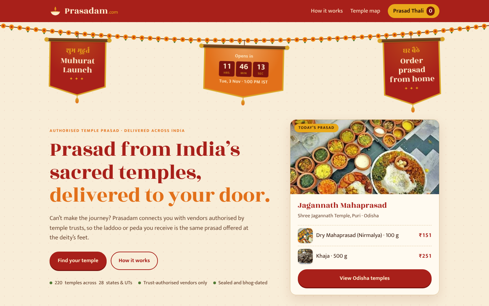
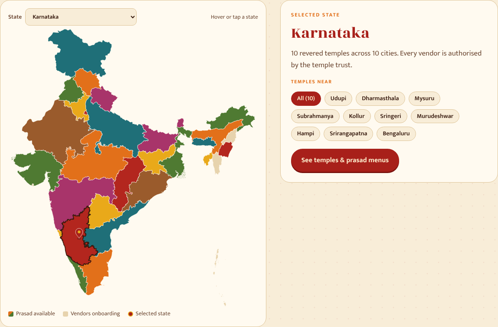

# Prasadam.com

**Verified temple prasad, delivered home.**

Prasadam.com connects devotees who cannot travel with prasad from the temples they love. Every pack comes from a vendor authorised by the temple trust, is sealed and dated, and is tracked to the door.

**Live site:** https://abhisat16.github.io/Prasadam.com/

This repository holds the clickable MVP prototype that launches at the *shubh muhurat* on **3 November 2026, 1:00 PM IST**, plus the business and product documents behind it.

> **Prototype notice.** Temple listings, prices and quantities are demo data. No real orders or payments are taken. Prasadam.com is not yet affiliated with any temple named on the site; partnerships will be signed through MoUs before any live listing (see `docs/`).



## The story

Ramesh is 62, retired in Bengaluru, and can no longer travel to Shirdi. India Post asks him for an e-money order, temple websites cover one temple each, faith-tech apps treat prasad as an add-on to online puja, and marketplaces have sold fake “prasad”. Prasadam.com gives him one trusted place: choose a temple, pay by UPI, track the sealed box home.

## What the prototype does

- **Muhurat launch banners** hanging from a marigold garland, with a live countdown to 3 Nov 2026, 1:00 PM IST. After launch they switch to “Now live”.
- **A real map of India** (state boundaries). Hover to see a state and its temple count, click to select it, or pick it from the dropdown.
- **Temple cards with real photos** for every partner-style listing, filterable by city, each with its own **prasad menu** and a photo for every item.
- **Prasad Thali (cart)** with quantities, free delivery above ₹499, and a demo checkout that validates name, mobile number and PIN code.
- **Pre-book before launch, order after launch**, ending in an order ID and a tracking timeline.
- Mobile-friendly layout, keyboard accessible map, reduced-motion support.



## Run it locally

No build step is needed. Serve the folder with any static server:

```bash
git clone https://github.com/abhisat16/Prasadam.com.git
cd Prasadam.com
python3 -m http.server 8000
# open http://localhost:8000
```

Opening `index.html` directly also works in most browsers.

## Publishing

The site is published with GitHub Pages. The workflow in `.github/workflows/pages.yml` deploys it on every push to `main` (Settings → Pages → Source: GitHub Actions).

## Project structure

```
Prasadam.com/
├── index.html                 Page markup
├── assets/
│   ├── css/styles.css         Design tokens and styles (traditional palette)
│   ├── js/app.js              Temple data, map, cart, checkout and countdown
│   ├── img/                   Temple and prasad photos (see CREDITS.md)
│   └── screenshots/           Images used in this README
├── docs/
│   ├── PrasadSetu_BRD.docx    Business requirements document
│   ├── PrasadSetu_PRD.docx    Product requirements document
│   ├── Prasad_Delivery_Market_Competitor_Analysis.xlsx
│   └── pitch-deck.md          Pitch deck outline and link
├── CREDITS.md                 Photo credits and licences
├── LICENSE                    MIT licence for the code
└── .github/workflows/pages.yml
```

## Design

| Token | Colour | Use |
|---|---|---|
| Kumkum | `#A8201A` | Header, headings, primary buttons |
| Kesar | `#E2701A` | Accents, eyebrows |
| Haldi | `#E9A91A` | Highlights, cart badge |
| Mehendi | `#4F7A32` | Trust badges |
| Chandan | `#F8EDD8` | Page background |

Typefaces: **Rozha One** for headings and **Mukta** for text (Google Fonts), both of which cover Latin and Devanagari.

## Business plan in brief

- **Pilot:** one state, 3–5 signed temples, dry shelf-stable prasad only, prepaid orders only.
- **Unit economics (base case):** ₹400 order → ₹200 to the temple, ₹130 courier, packaging and gateway → **₹70 contribution (17.5%)**. Break-even near 4,300 orders a month at ₹3 lakh fixed cost.
- **Growth levers:** festival and gift packs, subscriptions, a temple software fee, NRI shipping.
- **Roadmap:** Validate (months 0–2) → Pilot (2–4) → Grow (5–9) → Scale (10–18).

Full detail is in `docs/`.

## Roadmap for the code

- [ ] Hindi interface (language switch)
- [ ] Real payment gateway (UPI, cards, net banking)
- [ ] Temple dashboard: dispatch list, labels, payouts
- [ ] Admin panel: MoU and FSSAI checks before any listing goes live
- [ ] Courier tracking integration

## Credits

Temple and most prasad photos come from Wikimedia Commons and keep their original licences; each photo is credited on the site and in [CREDITS.md](CREDITS.md). The India state map is from [svg-maps/india](https://github.com/VictorCazanave/svg-maps) (CC BY 4.0).

## Licence

Code is released under the [MIT licence](LICENSE). Photos are not covered by the MIT licence; see [CREDITS.md](CREDITS.md).
